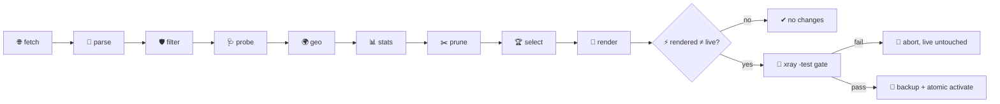

# 🌍 public_vpn

<div align="center">

## 🛰️ public_vpn — a geo-diverse location pool for your xray client

*Fetch, probe, geo-enrich, rank, render, and maintain a pool of third-party public proxy nodes — explicitly routed, never your default route.*

[](https://go.dev/)
[](#-testing)
[](https://github.com/XTLS/Xray-core)
[](DESIGN.md)
[](.golangci.yml)

[🚀 Quick Start](#-quick-start) · [🗺️ Pipeline](#️-pipeline) · [🧭 maintain](#-what-happens-on-maintain) · [🔒 Security](#-security-model) · [⚙️ Configuration](#️-configuration) · [📖 Design](DESIGN.md)

</div>

---

## 📑 Table of Contents

- [✨ What It Does](#-what-it-does)
- [🗺️ Pipeline](#️-pipeline)
- [🧭 What Happens on `maintain`](#-what-happens-on-maintain)
- [📂 Project Structure](#-project-structure)
- [🚀 Requirements](#-requirements)
- [⚡ Quick Start](#-quick-start)
- [⏱️ Timers (systemd user units)](#️-timers-systemd-user-units)
- [🔒 Security Model](#-security-model)
- [⚠️ Landmine Warnings](#️-landmine-warnings)
- [⚙️ Configuration](#️-configuration)
- [✅ Testing](#-testing)
- [🗺️ Roadmap](#️-roadmap)

## ✨ What It Does

`publicvpn` is a single-binary Go pipeline that keeps a **cold base** (`geo-base.jsonl`: country / city / ASN / ISP per node) of hundreds of third-party public proxy nodes and promotes a small **active core** (20–25, expandable to 40 for city coverage) into your xray client config. Every pool outbound carries the owner-mandated hardening (`sockopt.tcpMaxSeg: 1440`, TLS fingerprint `firefox`), every link parameter passes through **1:1** — nothing is rewritten behind your back.

**The pool never becomes the default route.** It participates only in routing rules you explicitly configure (`[render.pool_routes]`); everything else — including the catch-all — stays on your own nodes.

## 🗺️ Pipeline



| Stage | Binary | What it owns |
| :-- | :-- | :-- |
| 🌐 fetch | `publicvpn fetch` | dynamic GitHub source discovery (repo ids + manifests, **no pinned URLs**), cached downloads |
| 📜 parse | `publicvpn parse` | base64/URI decode of `vless\|vmess\|trojan`, normalize, dedupe by identity hash |
| 🛡️ filter | `publicvpn filter` | keep `reality\|tls` only, drop `allowInsecure`, drop private hosts, per-source caps |
| 🩺 probe | `publicvpn probe` | out-of-band `xray-knife`: liveness, RTT, tunnel exit IP (D8), optional `-S` speedtest |
| 🌍 geo | `publicvpn geo` | ip-api.com batch enrichment of exit IPs (rate-capped, L6) |
| 📊 stats | `maintain` sub-step | `xray api statsquery` poll → per-outbound uplink/downlink into the cold base |
| ✂️ prune | `maintain` sub-step | dead/ttl-stale-orphan removal with a `.bak-<ts>` backup |
| 🏆 select | `publicvpn select` | rank (alive → checks → speed), per-country cap K, soft cap N with city expansion (D7) |
| 📝 render | `publicvpn render` | template + pool outbounds + balancers + Plan A observatory, L1-gated |
| ⚡ activate | `publicvpn activate` | `-test` gate → date-stamped backup → atomic replace. **Never restarts the service.** |

## 🧭 What Happens on `maintain`

One `publicvpn maintain` invocation runs the whole refresh wave end-to-end:

1. **fetch** — resolve current source paths and download changed files into the cache.
2. **parse** — decode the cached bodies into normalized node records.
3. **filter** — apply the ingest security filter; the survivors are the wave's reference set.
4. **probe** — out-of-band xray-knife liveness + exit-IP discovery (skipped by `--skip-probe`).
5. **geo** — batch-enrich the fresh exit IPs via ip-api (skipped together with probe).
6. **stats** — poll `xray api statsquery -pattern "outbound>>>pool-" -reset=true` on `127.0.0.1:<stats_port>` and fold the per-outbound byte deltas into `geo-base.jsonl`. A poll failure is a loud warning, not a wave failure (accounting must not block node refresh).
7. **prune** — remove records that are dead beyond `[maintain].prune_dead_after` (default 48h) or that rank's TTL already refuses *and* whose source dropped; every removal pass leaves `geo-base.jsonl.bak-<ts>` next to the store.
8. **select** — re-rank from the cold base; rank's TTL freshness gate drops stale-alive records on its own, so `--skip-probe` waves reselect safely from cold data.
9. **render** — rebuild the full client config (template + pool + balancers + observatory, stats/policy ensured).
10. **activate-if-changed** — if the rendered bytes equal the live config: `no changes`, nothing touched. Otherwise the W3 activate path runs: `xray run -test` gate → date-stamped backup → atomic replace. **The service is never restarted** — the command prints the restart hint for you.

`--no-activate` stops after the render+diff. `--speedtest` adds the slow throughput measurement to the probe stage (that is the weekly timer's wave).

## 📂 Project Structure

```text
public_vpn/
├── cmd/publicvpn/          # main.go — cobra root wiring
├── internal/
│   ├── cli/                # command tree + maintain orchestration (stage seam)
│   ├── config/             # strict-decode TOML (unknown keys fail loud), no env vars
│   ├── model/              # Node, GeoRecord (§5 cold-base schema), tag contracts (D5/D6)
│   ├── fetch/              # D9 dynamic discovery + cached downloads (L5 proxy-stripped)
│   ├── parse/              # base64/link decoding → normalized Node
│   ├── filter/             # ingest security filter
│   ├── probe/              # xray-knife out-of-band runner (L5)
│   ├── geo/                # ip-api batch enrichment (L6 rate caps)
│   ├── stats/              # W4 statsquery poll + byte folding (L7-tolerant)
│   ├── prune/              # W4 dead/ttl-stale-orphan rules (reuses rank freshness)
│   ├── rank/               # select stage: ranking, caps D7, pool tags
│   ├── render/             # W3 renderer: outbounds, balancers, Plan A observatory, L1 gate
│   ├── activate/           # -test gate + backup + atomic replace (never restarts)
│   └── store/              # JSONL cold base, probe log, selection — all writes atomic
├── systemd/                # user timer units (repo files only — you install them)
├── config.toml             # the single source of truth
└── DESIGN.md               # full design: decisions D1–D11, landmines, resource budget
```

## 🚀 Requirements

- **Go ≥ 1.27** to build (`go build -o publicvpn ./cmd/publicvpn`).
- **xray-core 26.3.27** present locally (the `-test` gate and the stats API both exec it; do **not** upgrade the core — L11).
- **xray-knife ≥ v10.1.0** on `PATH` or `[probe].path` for the probe stage.
- A working xray client config to use as the render template (read-only reference — the renderer never writes your template).

## ⚡ Quick Start

1. **Create `config.toml`** — start from the repo default: set `data_dir`, review `[sources.*]` (D9 discovery means only repo ids live here), and declare your pool routes under `[[render.pool_routes]]` (D2: no routes → the pool is built but carries nothing).
2. **`publicvpn fetch`** — discover and cache the source files.
3. **`publicvpn probe`** — out-of-band liveness + exit-IP wave (add `--speedtest` for the weekly-style throughput measurement).
4. **`publicvpn geo`** — enrich the exit IPs into the cold base.
5. **`publicvpn select`** — rank and cap the active set.
6. **`publicvpn render`** — render the full client config into `rendered/config.json`.
7. **`publicvpn activate`** — `-test` gate, backup, atomic replace of `[activate].target`, then restart your client when you are ready (`systemctl --user restart xray-raw.service` — the binary prints this hint, it never restarts by itself).
8. **`publicvpn maintain`** — from now on, one command (or the shipped timers) does the whole wave, activating only on real diffs.

## ⏱️ Timers (systemd user units)

`systemd/` ships the refresh timer (every 6 h) and the weekly speedtest timer as **repo files** — nothing is installed or enabled for you:

```bash
cp systemd/public_vpn-*.service systemd/public_vpn-*.timer ~/.config/systemd/user/
systemctl --user daemon-reload
systemctl --user enable --now public_vpn-refresh.timer public_vpn-speedtest.timer
```

Full install steps and a journald cheatsheet live in [systemd/README.md](systemd/README.md).

## 🔒 Security Model

- **Every node operator is a man-in-the-middle by design.** They see your DNS queries, inner SNI, timing, and traffic volumes. REALITY's `pbk` proves the operator to you — it proves nothing about the operator to you.
- **Disposable traffic only.** The pool exists for geo-diversity: scraping, region checks, location-specific services. Logins, banking, and anything identity-bearing stay off it — your own nodes remain the default transport for everything else.
- **The trust wall is structural, not advisory.** Pool traffic reaches only `[render.pool_routes]` destinations; the template's existing rules (RU-direct, SMTP-block, torrent-direct) keep precedence, so the pool can never carry them even by mistake.
- **Ingest hygiene is a hard filter.** `allowInsecure=1` links, non-TLS transports, and private/loopback hosts never reach the cold base; forward-secrecy transports (`reality`/`tls`) only.
- **The `-test` gate is unconditional.** A config that fails validation never replaces the live file — a crash-looping client is the one failure mode this pipeline refuses to create.
- **Credentials stay local.** The rendered config and pipeline state are written `0600`; the repository ships no secrets and no pinned node URLs.

## ⚠️ Landmine Warnings

- **L1 — never render an observatory with an empty selector.** On xray-core 26.3.27 (pre-#6666) it busy-loops a CPU core; the renderer hard-refuses that shape on any pool state.
- **L4 — DNS goes through NSS.** Hostname resolution uses the system resolver; direct-to-public-DNS probing is dead on split-brain setups and must not be reintroduced.
- **L5 — strip proxy env on every network call.** The ambient `http_proxy` points at your own client; an unstripped fetch, probe, or stats dial silently tunnels through the very VPN it is measuring.
- **L6 — respect ip-api's free tier.** HTTP-only endpoint, ≤100 IPs per batch, ≤15 batch requests/min; ignoring the rate headers risks a 1-hour ban for the whole pipeline.
- The full list (L1–L12) with rationale lives in [DESIGN.md §8](DESIGN.md).

## ⚙️ Configuration

Everything lives in `config.toml` — unknown keys fail loud, there are no env-var overrides.

| Section | Owns | Notable keys |
| :-- | :-- | :-- |
| `[sources.*]` | upstream feeds (D9) | `repo`, `discovery`, `include`, `enabled` |
| `[fetch]` | download behavior | `timeout`, `retries`, `concurrency`, `cache_max_age` |
| `[filter]` | ingest security | `source_cap` (per-source cap per wave) |
| `[probe]` | xray-knife wave | `path`, `threads`, `url`, `speedtest`, `check_preset`, `max_passed` |
| `[geo]` | ip-api enrichment | `endpoint`, `batch_size`, `per_minute`, `ttl` |
| `[select]` | ranking caps (D7) | `per_country_cap`, `soft_cap`, `city_expand_threshold`, `ceiling` |
| `[render]` | client config render | `template`, `output_dir`, `stats_port`, `pool_routes` |
| `[activate]` | activation | `target`, `xray_bin`, `asset_dir`, `backup_dir` |
| `[maintain]` | W4 maintenance wave | `prune_dead_after` (default `48h`) |

## ✅ Testing

```bash
go test ./... -count=1        # full suite
go test -race -count=1 ./...  # race detector
golangci-lint run             # strict gate: 0 issues, caps disabled
```

The suite covers every stage with hermetic fixtures: mocked-stage maintain orchestration (order, no-op-when-unchanged, failed `-test` gate), real-shaped `statsquery` responses (missing-counter tolerance included), prune boundaries and backup semantics, render golden regression, and pure content assertions on the systemd units.

## 🗺️ Roadmap

- **VPS probe mode (D10)** — run the probe stage on a rented server and sync results back, trading home-IP footprint for infrastructure.
- **Panel-side integration** — explicitly out of scope; this pipeline is a local single-binary tool and stays one.
