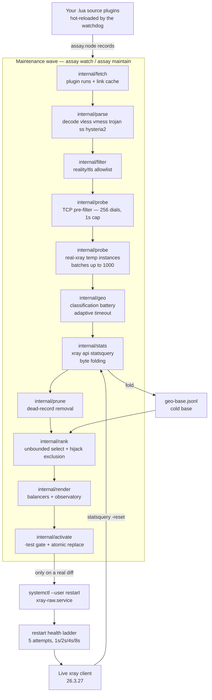

# 🧪 Assay

<div align="center">

**Self-hosted pool manager for third-party public proxy nodes**

Assay turns public xray share links into a geo-diverse, continuously re-verified pool inside your own xray client — every alive node classified through its own tunnel, rendered into per-location balancers, and activated only through a `-test` gate.

[](https://go.dev/)
[](https://github.com/XTLS/Xray-core)
[](https://www.freedesktop.org/wiki/Software/systemd/)
[](https://github.com/yuin/gopher-lua)
[](https://toml.io/)

[](https://github.com/4q4r/assay/blob/main/LICENSE)
[](https://github.com/4q4r/assay/commits/main)
[](https://github.com/4q4r/assay)
[](https://github.com/4q4r/assay)

[Architecture](#-system-architecture) · [Quick Start](#-quick-start) · [CLI](#-cli-surface) · [Configuration](#-configuration) · [Security](#-security) · [Testing](#-testing)

</div>

---

## 📑 Table of Contents

- [What is assay](#-what-is-assay)
- [System architecture](#-system-architecture)
- [Project tree](#-project-tree)
- [Quick Start](#-quick-start)
- [CLI surface](#-cli-surface)
- [Configuration](#-configuration)
- [Security](#-security)
- [Observability](#-observability)
- [Testing](#-testing)
- [License](#-license)

---

## ✨ What is assay

`assay` is a single-binary Go CLI + daemon that manages a pool of third-party public proxy/VPN nodes for your xray client. A systemd **user** watch daemon runs scheduled maintenance waves (default hourly, configurable): Lua-plugin ingest sources bring raw share links in — tens of thousands of candidates per wave — then a TCP pre-filter discards dead endpoints before any xray process is booted, the survivors are probed through **real temporary xray instances** (batches up to 1000 nodes per process), and every node the probe proves alive gets the full classification battery through its own still-hot tunnel. Selection is unbounded by default (all alive nodes go active) with a TLS-intercept exclusion gate, the renderer emits per-country/city/service balancers with observatory coverage, and activation replaces the live client config only after a passing `xray run -test` gate — followed by the daemon's own restart and health check.

**Sources are bring-your-own.** The repository ships exactly one tracked ingest plugin — `internal/plugins/defaults/sample.lua` — a documented, working template of the full host API. It materializes into the plugins dir on first run; every other source is a `.lua` file you drop into the plugins dir, hot-reloaded by the daemon. Nothing provider-specific ships in-repo.

**Explicit non-goals.** Assay is not a VPN provider: it runs no servers, holds no accounts, and makes no promises about nodes it does not control — it curates third-party public nodes someone else operates, for disposable geo-diverse traffic only. The pool never becomes your default route: it participates exclusively in routing rules you declare under `[[render.pool_routes]]`, and every pool balancer falls back to `block`, never to direct. The transport class RF censors block behaviorally is filtered at ingest (the security filter admits only forward-secrecy `reality`/`tls` links and drops `allowInsecure`), and every pool outbound carries the calibrated anti-TSPU TCP MSS clamp — hardening at the margins, not invisibility.

## 🏗 System architecture



Request flows:

1. **A maintenance wave, end to end.** The `assay watch` daemon (or a one-shot `assay maintain`) fires a wave: every `.lua` plugin in the plugins dir runs inside the gopher-lua sandbox and hands raw links to `internal/fetch`, which caches them (`internal/parse` decodes and dedupes by identity, `internal/filter` drops everything outside the `reality`/`tls` security policy). `internal/probe` first runs the TCP pre-filter — one plain dial per unique endpoint, no xray boot — then probes the survivors through real temporary single-node xray instances in batches of up to 1000 (a batch that dies as a batch retries at half size, recursively). While each node's tunnel is proven working, `internal/geo` runs the classification battery through the same instance. `internal/stats` polls the live client's `xray api statsquery` and folds per-outbound byte deltas into the cold base (failures are warning-class — accounting never blocks a wave, but a fold/write failure fails loud: traffic data loss is never silent), and `internal/prune` removes records that are dead beyond `[maintain].prune_dead_after` with a backup beside every removal pass. `internal/rank` then selects — unbounded by default — and `internal/render` rebuilds the full client config with balancers and observatory; `internal/activate` applies it only when the rendered bytes differ from the live file, gated, backed up, and replaced atomically. One dead plugin never kills the wave: per-plugin failures are loud and the healthy sources carry on.
2. **One node's classification battery.** Per alive node, through the SAME hot temp instance: the tunnel-alive gate (a `generate_204` probe against gstatic primary and the Cloudflare twin as fallback) decides whether the battery runs; a dead gate can still be rescued by the cftrace equalizer — a parseable `ip=` answer from the Cloudflare trace echo marks the node alive with the rescue recorded. Then the exit-IP ladder runs (plain-HTTP ip-api self-report → HTTPS self-geo → through-tunnel DoH fallback → exit-IP echo recovery → unknown, every rung on the node's own evidence), the three-source echo consensus (cftrace + ipify + ip.sb, two agreeing sources pin the exit IP), the TLS-intercept hijack detector (certificate validation always on, plus a body-contract check of the plain-HTTP ip-api answer), DNS-over-TCP (TXT `o-o.myaddr.l.google.com` via `ns1.google.com`) and RFC 5389 STUN (hysteria2 nodes), the media-unlock battery (ChatGPT, Netflix, YouTube, Disney+, TikTok) and the ip-quality risk score. Each classification request gets an RTT-adaptive timeout — `clamp(10 × probe RTT, [geo].timeout floor, 30s ceiling)` — under a 20-minute per-node battery budget.
3. **The activation path.** `internal/activate` runs `xray run -test` on the rendered config; a failing gate aborts loud with the live config untouched. On success it takes a date-stamped backup and atomically replaces the target — then, when the wave runs with the default `[maintain].auto_restart = true`, the daemon restarts the live client (`systemctl --user restart xray-raw.service`, the only systemd write command it may run) and health-checks it on a bounded retry ladder: 5 attempts with 1s/2s/4s/8s backoff, pass on any attempt, all failing into a loud `health-failure` that names the backup. A daemon shutdown can pause the wave only between stages — never between the replace and the restart.

## 📦 Project tree

```text
assay/
├── cmd/assay/main.go             cobra root wiring
├── internal/
│   ├── cli/                      command tree, maintain orchestration, watch daemon, install/uninstall, status dashboard
│   ├── config/                   strict-decode TOML — unknown keys fail loud, no env vars
│   ├── model/                    node + geo-record schema, unlock vocabulary
│   ├── fetch/                    plugin runtime plumbing: cache, manifest, mirrors
│   ├── parse/                    base64/URI decoding → normalized node records
│   ├── filter/                   ingest security filter: reality/tls, allowInsecure drop, per-source caps
│   ├── probe/                    real-xray probe engine: pre-filter, batches, halving
│   ├── geo/                      classification battery: gate, ladder, consensus, hijack, media, risk
│   ├── checker/                  site-check engine: temp instances, blockpage classifier, socks5h client, DNS/STUN
│   ├── rank/                     selection: ranking, unbounded caps, hijack exclusion
│   ├── render/                   client-config renderer: transports, balancers, observatory
│   ├── activate/                 -test gate, backup, atomic replace
│   ├── restart/                  the restart executor (byte-pinned allowlist) + health ladder
│   ├── install/                  self-install: binary copy, config materialization, unit rendering
│   ├── stats/                    xray api statsquery polling + byte folding into the cold base
│   ├── prune/                    dead/stale record removal with backups
│   ├── store/                    JSONL cold base, probe log, selection — atomic writes
│   ├── plugins/                  gopher-lua sandbox, host API, registry, circuit breaker, embedded sample.lua
│   ├── watchdog/                 fsnotify hot-reload of the plugins dir, last-good semantics
│   ├── timeoutcal/               adaptive-timeout state (RTT calibration seam)
│   ├── sdnotify/                 sd_notify(3) READY=1 / WATCHDOG=1 pinger
│   ├── ui/                       the ONE terminal-styling owner: lipgloss palette, chips, tables
│   └── xrayupdate/               xray core updater: release resolve, sha256 verify, staging, rollback
├── systemd/                      assay-watch.service template (go:embed single source) + embed.go
├── docs/                         status-dashboard spec + implementation wave plans
├── config.example.toml           every knob with its default, schema comments
├── DESIGN.md                     design decisions D1–D11, landmines L1–L12
├── LICENSE                       MIT
├── .golangci.yml                 strict lint gate
└── go.mod / go.sum               Go 1.27, cobra, gopher-lua, fsnotify, lipgloss v2
```

## 🚀 Quick Start

### 1. Build

You need Go 1.27+ and a local xray binary (the pinned core is **26.3.27** — the probe, the site check, and the `-test` gate all exec `[activate].xray_bin`).

```bash
go build ./cmd/assay
```

### 2. Install

`./assay install` without `-c` is the canonical user deploy — everything lives under the XDG local-share layout:

```bash
./assay install
systemctl --user status assay-watch
```

The install copies the running binary to `~/.local/bin/assay` (atomic write, re-running after a rebuild is the self-upgrade flow), materializes a fully commented default config at `~/.local/share/assay/config.toml` (**mode 0600, never overwritten** — an existing file always wins), and renders the `assay-watch.service` user unit (Type=notify, WatchdogSec=300, Restart=always) running plain `watch`. systemd activation goes through a byte-pinned allowlist executor: exactly `daemon-reload`, `enable --now`, and `disable --now` on assay units — nothing else, ever. `assay uninstall` is the symmetric teardown; `--purge` additionally removes the config and data dir.

### 3. Bring your own sources

Drop `.lua` files into the plugins dir (`~/.local/share/assay/plugins/` by default) — one file is one source, the file name becomes the plugin id. The tracked template `internal/plugins/defaults/sample.lua` demonstrates the complete host API (`assay.node`, `assay.http`, `assay.base64`, `assay.github_files`, `assay.json`, `assay.log`) and materializes into the dir on first run. The chunk must be side-effect-free and return its collector function; Go owns URI parsing, dedupe, and filtering — the plugin only discovers. The `assay watch` daemon hot-reloads the dir on file changes: a new provider is a new file, no rebuild, no restart. Plugins that keep failing are retired by the circuit breaker (`[plugins].max_consecutive_failures`, default 5) and re-enabled by a file edit.

The minimal shape (a plain-HTTP subscription, decoded inline — the full GitHub / JSON-catalog variants live in the sample's comments):

```lua
local function collect()
  local ok, resp = pcall(assay.http, { url = "https://example.invalid/sub.txt" })
  if not ok or resp.status ~= 200 then
    error("fetch failed: " .. tostring(resp))   -- loud, plugin-attributed
  end
  local nodes = {}
  for line in resp.body:gmatch("([^\r\n]+)") do
    nodes[#nodes + 1] = assay.node{ raw = line }
  end
  return nodes
end
return collect
```

Every failure inside the collector is loud and feeds the breaker; a run that exceeds `[plugins].run_timeout` (default `120s`, explicit `0s` = unbounded) is abandoned and the wave continues.

### 4. Run & watch

The daemon is installed enabled. Follow the waves in the journal:

```bash
journalctl --user -u assay-watch -f
```

Each wave logs its stages fetch → parse → filter → probe → stats → prune → select → render → activate — the classification battery rides the probe stage (it runs through each node's still-hot tunnel right after the probe verdict, so there is no separate classify stage in the journal). Classification evidence lines carry the rollout tokens — `tmo=` (the node's adaptive per-request timeout), `gate_rescue=cftrace` (a gate-dead node rescued by the cftrace equalizer), `consensus=N` (agreeing exit-IP echo sources), and exit-ip churn notes — so you can verify what the battery actually saw. Fill `[render].template` and `[activate].target` in the materialized config to let the wave render and activate; until then every data stage still runs and the pool data is warm.

### 5. First checks

```bash
assay status                        # install state, config provenance, source verdicts
assay list                          # pool inventory by country: nodes, alive, median RTT
assay list --cities --all           # + city sub-rows and the cold base section
assay check nyaa.si --top 10        # rank the pool by how well each location serves a site
```

`status` renders the source dashboard (verdicts GOOD / FAIR / WEAK / POOR / DEAD, funnel and quality columns); `list` reads the same selection and probe data the render uses; `check` drives a URL through the alive pool — every alive node by default, capped at 60 (`--limit`) — each via its own temporary xray instance with exit-side DNS resolution and a blockpage classifier, and ranks by how well each location serves the site. Read-only, never activates.

## 📖 CLI surface

| Command | Purpose |
| :-- | :-- |
| `assay fetch` | Run the Lua source plugins and cache their raw links |
| `assay parse` | Decode cached bodies into normalized node records |
| `assay filter` | Apply the ingest security filter; survivors are the wave reference set |
| `assay probe` | TCP pre-filter + real-xray liveness/exit-IP wave, classification merged in |
| `assay select` | Rank and cap the active set (unbounded by default) |
| `assay render` | Rebuild the full client config into `rendered/config.json` |
| `assay activate` | `-test` gate → backup → atomic replace (+ gated auto-restart) |
| `assay maintain` | One full maintenance wave end to end (stats poll + prune included) |
| `assay status` | Install state, config resolution, source-quality dashboard |
| `assay install` | Canonical user deploy: binary + unit + default config (see Quick Start) |
| `assay uninstall` | Disable and remove the daemon unit; user data kept unless `--purge` |
| `assay check` | Site-to-location ranking through the alive pool (default cap 60 nodes; temp xray instances) |
| `assay list` | Pool inventory by country/city, `--json` machine-readable twin |
| `assay watch` | The daemon: plugin watchdog + scheduled waves (what install enables) |
| `assay xray-update` | Fetch the latest Xray-core release, sha256-verify, `-test`, atomic replace with rollback |

Every command accepts optional `-c <path>`; without it the config resolution order is the local-share default `~/.local/share/assay/config.toml`, then the deprecated legacy home location `~/.config/assay/config.toml` when it exists (still honored, with a loud move warning), then `./config.toml`, then configless built-in defaults — one file wins whole, nothing is ever merged, and the resolved source prints as a `config:` line.

## ⚙️ Configuration

Configuration is TOML — unknown keys fail loud, there are no env-var overrides. [`config.example.toml`](config.example.toml) documents every knob with its default (including `[http]`, `[resources]`, and `[self_update]`, not repeated here); the tables below carry the important ones.

**`[plugins]` — the source ingest**

| Knob | Default | Meaning |
| :-- | :-- | :-- |
| `dir` | `<data_dir>/plugins` | the watched source dir; embedded defaults materialize here on first run, 0600 |
| `run_timeout` | `120s` | bound on one plugin's whole fetch run; `0s` = unbounded |
| `max_consecutive_failures` | `5` | circuit breaker: N consecutive failures auto-disable the plugin; `0` = off |
| `max_duplicate_percent` / `min_live_percent` | off | threshold-based disable via the same breaker |

**`[fetch]` — the plugins' HTTP engine**

| Knob | Default | Meaning |
| :-- | :-- | :-- |
| `timeout` / `retries` / `concurrency` | `30s` / `3` / `4` | plugin transport defaults |
| `github_token` | *(empty)* | raises api.github.com rate limits |
| `api_base` / `raw_base` | GitHub defaults | mirror hosts for the `github_files` helper |

**`[probe]` — the real-xray wave**

| Knob | Default | Meaning |
| :-- | :-- | :-- |
| `threads` | `32` | parallel temp-instance workers |
| `batch_size` | `1000` | nodes per batch-mode xray process; batch deaths halve recursively to 20 |
| `attempts` | `3` | liveness GETs per node through `[probe].url` (default: the Cloudflare trace endpoint) |
| `tcp_prefilter` | `true` | plain TCP dial per endpoint before any boot (UDP transports bypass) |
| `tcp_prefilter_workers` / `_timeout` | `256` / `1s` | pre-filter dial concurrency and per-dial cap |
| `speedtest` | `false` | per-wave speedtest off by default; the weekly wave carries it |

**`[geo]` — classification**

| Knob | Default | Meaning |
| :-- | :-- | :-- |
| `timeout` | `8s` | the FLOOR of the adaptive per-request timeout |
| `unlock_probes` | `true` | the full battery runs on every probe-alive node; `false` = probe-only waves |
| `doh_url` | `https://dns.google/resolve` | through-tunnel DoH fallback endpoint |
| `https_url` | `https://ipinfo.io/json` | rung-2 HTTPS self-geo (any https endpoint accepted) |
| `exit_ip_echo_url` | `https://icanhazip.com` | HTTPS echo recovery when both self-report rungs fail entirely |
| `ttl` | `24h` | alive-data freshness for selection |

The adaptive timeout formula: each classification request gets `clamp(10 × the node's measured probe RTT, [geo].timeout, 30s)` — the knob is the floor, 30 seconds is the hard ceiling, and the ceiling wins when a configured floor sits above it. A node without a usable RTT measurement fails safe to the floor. The whole battery is bounded by a 20-minute per-node budget.

**`[select]` — unbounded selection**

| Knob | Default | Meaning |
| :-- | :-- | :-- |
| `per_country_cap` / `soft_cap` / `ceiling` | unbounded | absent or `0` = ALL alive nodes go active; explicit positives keep cap semantics |
| `tie_band_rtt_tolerance` | `1.2` | city tie-break band: rtt ≤ head·tolerance joins the band |
| `only_clean` | off | keep only nodes whose ip-quality evidence says hosting=false and proxy=false |

**`[render]` — the client config**

| Knob | Default | Meaning |
| :-- | :-- | :-- |
| `template` | *(placeholder)* | your xray client config as read-only structure reference |
| `pool_inbound_tags` | `socks-in, http-in` | must exist among template inbounds or the render fails loud |
| `observatory_interval` | adaptive | absent = `max(60s, ceil(active × 200ms))` — observatory load stays ≤ 5 probes/s at any pool size |
| `tcp_max_seg` | `1440` | emitted mandatorily on every pool outbound (anti-TSPU MSS clamp) |
| `tls_fingerprint` | `firefox` | uTLS fingerprint on tls/reality outbounds |
| `stats_port` | `15490` | the api/stats inbound bound to 127.0.0.1 only |
| `pool_routes` | *(none)* | the ONLY destinations that reach the pool — no routes, pool carries nothing |

The renderer emits one leastLoad balancer per location: `pool_<cc>` per country, `pool_<cc>_<city>` when a city has ≥ 2 live nodes (single-node cities render a direct `pool-<cc>-NN` tag), `pool_unknown` for the unknown-geo group, and `pool_all` spanning the whole pool. Balancers select only observatory-covered outbounds, and a route target that is neither a rendered balancer nor a direct pool tag fails the render loud.

**`[activate]` — gated activation**

| Knob | Default | Meaning |
| :-- | :-- | :-- |
| `target` | *(placeholder)* | the live client config to replace atomically |
| `xray_bin` | `/usr/bin/xray` | the core binary behind the `-test` gate, the probe, and `xray-update` |
| `test_timeout` | `30s` | bounds the `xray run -test` child; `0s` = no deadline |
| `backup_keep` | `0` | retain only the N newest config backups (`0` = unlimited) |
| `service_name` | `xray-client.service` | names the printed manual-restart hint; the auto path is pinned to `xray-raw.service` |

**`[maintain]` — the daemon schedule**

| Knob | Default | Meaning |
| :-- | :-- | :-- |
| `refresh_interval` | `1h` | refresh wave cadence (5m floor) |
| `speedtest_interval` | `168h` | weekly speedtest wave; `"0s"` disables the wave entirely |
| `auto_restart` | `true` | the daemon restarts the live client after every gated activation and health-checks it |
| `stats_timeout` | `10s` | bounds one `xray api statsquery` exec |
| `prune_dead_after` | `48h` | dead records older than this are pruned (with a backup) |

## 🔒 Security

- **The Lua sandbox is a hard callable surface.** gopher-lua opens only `base`, `string`, `table`, `math` — no `os`, no `io`, no `package`, no `debug`; `dofile`/`loadfile`/`print`/`require`/`module`/`newproxy` are stripped from `_G`. A plugin can only call the documented host API, every failure is loud and plugin-attributed, and runs exceeding `[plugins].run_timeout` are abandoned while the wave continues.
- **Every pool balancer fails closed.** All of them carry `fallbackTag: "block"` — a location with no healthy candidate blackholes instead of falling back to direct, and the pool reaches only the destinations listed under `[[render.pool_routes]]`.
- **TLS-intercept hijacking is detected and excluded.** The battery's hijack detector validates certificates (always on — the seam defaults to the system pool) and contracts the plain-HTTP ip-api body against the known fake-answer signature; a node with hijack evidence on its OWN geo record is excluded from selection after the probe gate — positive evidence only, never a sibling's record, and excluded nodes consume no selection slots.
- **The `-test` gate is unconditional.** A config that fails `xray run -test` never replaces the live file; every replace is preceded by a date-stamped backup, and every write (config materialization, cold base, rendered configs, backups) is atomic.
- **The daemon's systemd surface is byte-pinned.** Install may run exactly its allowlisted invocations — `daemon-reload` and `enable`/`disable --now`, always `--user` and always on assay units; the restart executor may run exactly `systemctl --user restart xray-raw.service` plus a read-only `is-active`. Guard tests pin the command sets; config knobs cannot widen the surface (`[activate].service_name` names the manual hint only).
- **Ingest hygiene is a hard filter.** Links outside the `[filter].protocols` allowlist, without `reality`/`tls` security, or carrying `allowInsecure` never reach the cold base; every wave re-filters and re-probes — trust extends only to the most recent evidence.
- **Evidence discipline is per-node and through its own tunnel.** Exit geo is keyed on the exit IP observed through the node's connection (never the advertised host), each candidate's verdict rides its own battery record, and provenance markers (`self-report`, `self-report-https`, `doh-fallback`) stay next to the fields they describe.
- **Byte-stability is pinned, not promised.** Color-off output, legacy verdict chips, and the machine-readable JSON twins are golden-pinned; probe-classification changes that must not alter output are proven byte-identical by tests.

## 📊 Observability

**The status dashboard** (`assay status`) renders per-source verdicts — **GOOD / FAIR / WEAK / POOR / DEAD** — computed from a pool-relative percentile composite (liveness, alive rate, geo breadth, classification cleanliness, unique yield) with a trend modifier; cold-start sources get an honest NEW/NONE state instead of a fabricated band. It also prints the wave funnel (links → filtered → probe-alive → classified → selected), quality columns, media-unlock counts, and the per-source sparkline history.

**The journal carries rollout evidence.** Every classification decision logs its tokens, so a wave can be audited without re-running it:

| Token | Meaning |
| :-- | :-- |
| `battery=vN alive=…` | battery schema version and the tunnel-alive gate result |
| `tmo=<duration>` | the node's effective adaptive per-request timeout for this run |
| `gate_rescue=cftrace ip=<exit>` | both gate endpoints failed but the cftrace echo answered — the node was rescued and the evidence recorded |
| `consensus=N` | how many exit-IP echo sources agreed (cftrace / ipify / ip.sb) |
| `exit-ip churn` | the node's exit IP changed between the probe wave and its self-report — the fresher tunnel truth wins |

**Machine-readable twins.** `assay list --json` and `assay status --json` print exactly one JSON document each — no banners, no ANSI — pinned byte-for-byte by golden tests. The `list` twin's schema:

| Field | Type | Meaning |
| :-- | :-- | :-- |
| `generated_at` | string | the selection's generation timestamp |
| `config` | object | resolved config source (`path` omitted when configless) |
| `selection` | object | the selection file read and its node count |
| `countries[]` | array | the active core grouped by country; unknown-geo nodes form their own `🏳` entry |
| `balancers[]` | array | the routing targets the current selection produces, with node counts |
| `cold_base` | object, `--all` | the cold base grouped the same way |

`status --json` carries its `schema_version`, the verdict/funnel/quality blocks with explicit nulls for absent evidence, and per-source rows. Color follows `--color auto/always/never` and `NO_COLOR`, and color-off output is byte-stable.

## 🧪 Testing

```bash
go test -race -count=1 ./...    # the full suite, race detector on
go build ./... && go vet ./...  # build + vet clean
golangci-lint run               # strict gate: zero issues
```

The full suite passes under `-race`. It is hermetic: temp xray instances boot through a real `StartTempXray` scan, the plugin matrix runs the host API over `httptest`, and the render goldens are **validated against the real xray binary in the default suite** (`xray run -test` on every golden transport).

- **Dynamic repro probes are the acceptance discipline.** Lifecycle, networking, seam, and CLI changes are accepted only with a dynamic reproduction: the defect is reproduced against real behavior first (RED), then the fix is proven against the same probe (GREEN) — review findings are verified live against the code, not accepted from a report.
- **The boot-smoke flake protocol is documented, not folk wisdom.** Temp instances boot into a test port band disjoint from production (`28500–28799`, pinned by `TestMain` via `SetTestPortBand`), because the live watch daemon churns the production `18xxx` band hourly — full `-race` runs historically flaked against that live churn, and the band pin is the fix. A residual cross-process contention flake in the boot smoke clears with a single isolated rerun.
- **`live`-tagged tests exist but never run by default.** Real-source plugin sweeps and real-xray lifecycle checks run behind `-tags live`, so the default suite stays hermetic.

## 📄 License

[MIT](LICENSE) © 2026 4q4r
