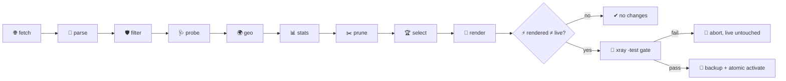

# 🌍 public_vpn

<div align="center">

## 🛰️ public_vpn — a geo-diverse location pool for your xray client

*Fetch, probe, geo-enrich, rank, render, and maintain a pool of third-party public proxy nodes — explicitly routed, never your default route.*

[](https://go.dev/)
[](#-testing)
[](https://github.com/XTLS/Xray-core)
[](DESIGN.md)
[](.golangci.yml)

[🚀 Quick Start](#-quick-start) · [🗺️ Pipeline](#️-pipeline) · [🧭 maintain](#-what-happens-on-maintain) · [📦 install](#-self-install--uninstall) · [🔒 Security](#-security-model) · [⚙️ Configuration](#️-configuration) · [📖 Design](DESIGN.md)

</div>

---

## 📑 Table of Contents

- [✨ What It Does](#-what-it-does)
- [🗺️ Pipeline](#️-pipeline)
- [🔌 Link & Transport Support](#-link--transport-support)
- [🧭 What Happens on `maintain`](#-what-happens-on-maintain)
- [🌍 Site check (`check`)](#-site-check-check)
- [📂 Project Structure](#-project-structure)
- [🚀 Requirements](#-requirements)
- [⚡ Quick Start](#-quick-start)
- [📦 Self-install / uninstall](#-self-install--uninstall)
- [⏱️ Timer Periods (configurable)](#️-timer-periods-configurable)
- [🔒 Security Model](#-security-model)
- [⚠️ Landmine Warnings](#️-landmine-warnings)
- [⚙️ Configuration](#️-configuration)
- [✅ Testing](#-testing)
- [🗺️ Roadmap](#️-roadmap)

## ✨ What It Does

`publicvpn` is a single-binary Go pipeline that keeps a **cold base** (`geo-base.jsonl`: country / city / ASN / ISP per node) of hundreds of third-party public proxy nodes and promotes a small **active core** (20–25, expandable to 40 for city coverage) into your xray client config. Every stream-based pool outbound carries the owner-mandated hardening (`sockopt.tcpMaxSeg: 1440`, TLS fingerprint `firefox`; hysteria2 outbounds are QUIC/UDP and carry the fingerprint without the TCP-only clamp), every link parameter passes through **1:1** — nothing is rewritten behind your back.

**The pool never becomes the default route.** It participates only in routing rules you explicitly configure (`[render.pool_routes]`); everything else — including the catch-all — stays on your own nodes.

## 🔌 Link & Transport Support

The render surface targets **your pinned core (xray 26.3.27)** — every field name and every "removed" verdict below is verified against both the real binary (`xray run -test`) and the tagged Xray-core source. Links carrying a transport this core cannot express **fail the render loud with the param named** — never a silent rewrite (L9).

| Link `type=` | Rendered as | Notes |
| :-- | :-- | :-- |
| `tcp` / `raw` | `tcp` + `tcpSettings` | `headerType=http` renders the http-obfs request block (`host`/`path` from the link); other header types refused loud |
| `ws` / `websocket` | `ws` + `wsSettings` | `path`, independent `host` (the deprecated `headers.Host` spelling is not emitted), `ed` appended into the path query (that is where the core reads it), `ehs` accepted only as the fixed `Sec-WebSocket-Protocol` |
| `httpupgrade` | `httpupgradeSettings` | `path`, `host`, same `ed`-in-path mechanics |
| `grpc` | `grpcSettings` | `serviceName`; `mode=multi` → `multiMode` (deprecated transport — the core warns but accepts) |
| `kcp` / `mkcp` | `kcp` (maximally bare — **no `kcpSettings` block is rendered at all**) | **`seed`/`headerType` are build-fatal on 26.3.27** — the mKCP header/seed feature was removed (migrated upstream to finalmask/mkcp-original/mkcp-aes128gcm), so a link carrying either key fails the render loud; any other kcp-namespaced param lands in the drop report |
| `xhttp` / `splithttp` | `xhttp` + `xhttpSettings` | `mode`, `path`, `host`, and an `extra` JSON-object passthrough (validated) |
| `http` / `h2` / `h3` | **refused loud** | the HTTP/2 transport was removed from 26.3.27 (→ XHTTP stream-one) |
| `quic` | **refused loud** | removed from 26.3.27 (→ XHTTP stream-one H3) |
| *(scheme)* `hysteria2` / `hy2` | `hysteria` outbound (version 2) + `hysteriaSettings` | a real hysteria2 client exists in 26.3.27 (verified against the binary + tagged source): `security=tls` renders unconditionally (the QUIC dialer refuses to run without it), the credential rides `hysteriaSettings.auth`, `sni`/`pinSHA256`/`ech` map 1:1 to `tlsSettings` (`pinnedPeerCertSha256`/`echConfigList`), fingerprint `firefox` applies, and **no `tcpMaxSeg`** renders (TCP-gated upstream; QUIC dials UDP). `obfs`/`obfs-password` (salamander) **fail the render loud** — the core has no salamander. Port-hopping links (`:123,5000-6000`) are malformed at parse. |

Security layers: `none` (no TLS settings rendered), `tls` (`sni`→`serverName`, `alpn`, `fp` overridden to `firefox`), `reality` (`pbk`/`sid`/`spx`/`pqv`→`mldsa65Verify`, fingerprint `firefox`; only with `tcp`/`xhttp`/`grpc` — the core's own restriction, enforced at render time).

Protocols: `vless`, `vmess` (incl. the JSON vocabulary: `net`/`type`/`host`/`path`/`scy`/`aid`, header datum preserved), `trojan`, **`ss`**, and **`hysteria2`** (with its documented `hy2://` alias) — parsed always, **accepted only when allowlisted** in `[filter].protocols` (default `vless,vmess,trojan`; ss and hysteria2 are opt-in). Shadowsocks renders as a `shadowsocks` outbound (`servers[0]` with `method`/`password` 1:1); SIP003 **plugin params cannot render** — the 26.3.27 shadowsocks outbound has no plugin support — so an ss link carrying `plugin=` fails the render loud. hysteria v1 links (`hysteria://`) stay rejected at parse: the core only speaks hysteria2 (version 2).

## 🗺️ Pipeline



| Stage | Binary | What it owns |
| :-- | :-- | :-- |
| 🌐 fetch | `publicvpn fetch` | dynamic GitHub source discovery (repo ids + manifests, **no pinned URLs**), cached downloads |
| 📜 parse | `publicvpn parse` | base64/URI decode of `vless\|vmess\|trojan\|ss\|hysteria2(hy2)`, normalize, dedupe by identity hash |
| 🛡️ filter | `publicvpn filter` | `[filter].protocols` allowlist (default `vless,vmess,trojan`), keep `reality\|tls` only, drop `allowInsecure` (policy knob), drop private hosts, per-source caps |
| 🩺 probe | `publicvpn probe` | out-of-band `xray-knife`: liveness, RTT, tunnel exit IP (D8), optional `-S` speedtest |
| 🌍 geo | `publicvpn geo` | ip-api.com batch enrichment of exit IPs (rate-capped, L6) |
| 📊 stats | `maintain` sub-step | `xray api statsquery` poll → per-outbound uplink/downlink into the cold base |
| ✂️ prune | `maintain` sub-step | dead/ttl-stale-orphan removal with a `.bak-<ts>` backup |
| 🏆 select | `publicvpn select` | rank (alive → checks → speed), per-country cap K, soft cap N with city expansion (D7) |
| 📝 render | `publicvpn render` | template + pool outbounds + balancers + Plan A observatory, L1-gated |
| ⚡ activate | `publicvpn activate` | `-test` gate → date-stamped backup → atomic replace. **Never restarts the service.** |

## 🧭 What Happens on `maintain`

One `publicvpn maintain` invocation runs the whole refresh wave end-to-end:

1. **fetch** — resolve current source paths and download changed files into the cache.
2. **parse** — decode the cached bodies into normalized node records.
3. **filter** — apply the ingest security filter; the survivors are the wave's reference set.
4. **probe** — out-of-band xray-knife liveness + exit-IP discovery (skipped by `--skip-probe`).
5. **geo** — batch-enrich the fresh exit IPs via ip-api (skipped together with probe).
6. **stats** — poll `xray api statsquery -pattern "outbound>>>pool-" -reset=true` on `127.0.0.1:<stats_port>` and fold the per-outbound byte deltas into `geo-base.jsonl`. Failures are classified: before your first activation (target lacks the rendered api/stats block, or the endpoint refuses connections) you get an **INFO** — *"stats will be available after the first activation + service restart; skipping accounting this wave"* — never a warning. A reachable endpoint that responds unexpectedly is a **WARNING** (accounting must not block node refresh). A fold/write failure into the geo-base **fails the wave loud** — traffic data loss is never silent.
7. **prune** — remove records that are dead beyond `[maintain].prune_dead_after` (default 48h) or that rank's TTL already refuses *and* whose source dropped; every removal pass leaves `geo-base.jsonl.bak-<ts>` next to the store.
8. **select** — re-rank from the cold base; rank's TTL freshness gate drops stale-alive records on its own, so `--skip-probe` waves reselect safely from cold data.
9. **render** — rebuild the full client config (template + pool + balancers + observatory, stats/policy ensured).
10. **activate-if-changed** — if the rendered bytes equal the live config: `no changes`, nothing touched. Otherwise the W3 activate path runs: `xray run -test` gate → date-stamped backup → atomic replace. **The service is never restarted** — the command prints the restart hint for you.

`--no-activate` stops after the render+diff. `--speedtest` adds the slow throughput measurement to the probe stage (that is the weekly timer's wave).

## 🌍 Site check (`check`)

```bash
publicvpn check nyaa.si https://speed.cloudflare.com/__down?bytes=25000000 --top 10
publicvpn check nyaa.si --countries NL,DE --attempts 3 --save reports/nyaa.json
```

For picky sites that open only from specific countries/cities/ASNs, `check` answers **"в каких странах/городах лучше держать матчинг-рулы"**: it drives the URL through EVERY pool node — each through its own **temporary single-node xray instance** (managed binary, socks inbound on a free `127.0.0.1:18xxx` port, the node's outbound built by the same `render.BuildOutbound` the live renderer uses **with the same hardening** — `tcp_max_seg` emitted mandatorily and the TLS fingerprint applied, straight from `[render]`) — and ranks the pool by how well each location actually serves the site. Resolution happens at the **exit** (`socks5h` semantics: hostnames ride the tunnel, never pre-resolved locally), and a supplementary `dns.google/resolve` query **through the tunnel** reports the IPs the exit's resolver sees (labeled `doh-via-exit`).

- **Per-attempt diagnostics** via `httptrace`: connect, TLS handshake (explicit probe, negotiated version reported), TTFB, total ms, bytes, avg speed — plus the full redirect chain and final URL.
- **Blockpages are classified, never silently successful**: `403/451/429/5xx` → `blocked-http`; a tiny 2xx body carrying a known block signature (Cloudflare `error code: 1015/1020`, Imperva, "Access Denied"…) → `blocked-page`. A node failing TLS for the target is a **distinct failure class** (`tls-fail`).
- **Geo summary + recommendation**: per-URL table over nodes, then country and city groups with success rate / median / avg ms / avg speed, and an explicit **recommendation block** — best countries/cities for matching rules for THIS url (feed the winners into `[render.pool_routes]`).
- **Read-only by construction**: the cold base and the live client are never touched, nothing is rendered or activated, all dialing is out-of-band. Liveness comes from the last probe wave — a staleness hint prints when the data is older than `[geo].ttl`.

| Flag | Default | Meaning |
| :-- | :-- | :-- |
| `--countries` | *(all)* | comma-separated ISO codes to filter the pool |
| `--limit` | `0` (all alive, ceiling 60) | max nodes to test |
| `--attempts` | `3` | HTTP attempts per node per URL |
| `--timeout` | `15s` | per-request timeout |
| `--top` | `10` | geo-summary/recommendation rows per block |
| `--concurrency` | `4` | parallel temp xray instances (each is a full process — keep modest) |
| `--with-dead` | off | include nodes not alive in the last probe |
| `--color` | `auto` | `auto` (colorize only on a terminal) / `always` / `never`; `NO_COLOR` forces auto off |
| `--no-color` | off | deprecated-friendly alias for `--color=never` (wins over a conflicting `--color`) |
| `--save` | *(none)* | write the JSON report under the data dir (relative path) or at an absolute path |

## 📂 Project Structure

```text
public_vpn/
├── cmd/publicvpn/          # main.go — cobra root wiring
├── internal/
│   ├── cli/                # command tree + maintain orchestration (stage seam) + install/uninstall commands
│   ├── config/             # strict-decode TOML (unknown keys fail loud), no env vars
│   ├── model/              # Node, GeoRecord (§5 cold-base schema), tag contracts (D5/D6)
│   ├── fetch/              # D9 dynamic discovery + cached downloads (L5 proxy-stripped)
│   ├── parse/              # base64/link decoding (vless/vmess/trojan/ss) → normalized Node
│   ├── filter/             # ingest security filter (protocols allowlist + insecure policy)
│   ├── probe/              # xray-knife out-of-band runner (L5)
│   ├── geo/                # ip-api batch enrichment (L6 rate caps)
│   ├── checker/            # W8 site-to-location check: temp xray instances, socks5h client, blockpage classifier, geo summary
│   ├── stats/              # W4 statsquery poll + byte folding (L7-tolerant)
│   ├── prune/              # W4 dead/ttl-stale-orphan rules (reuses rank freshness)
│   ├── rank/               # select stage: ranking, caps D7, pool tags
│   ├── render/             # W3/W5 renderer: full transport surface, balancers, Plan A observatory, L1 gate
│   ├── activate/           # -test gate + backup + atomic replace (never restarts)
│   ├── install/            # W5 self-install: binary copy, unit rendering, allowlisted systemctl seam
│   └── store/              # JSONL cold base, probe log, selection — all writes atomic
├── systemd/                # unit TEMPLATES (single source of truth, go:embed'd by install) + embed.go
├── config.example.toml     # sanitized template (defaults + schema comments); real config.toml stays local, gitignored
└── DESIGN.md               # full design: decisions D1–D11, landmines, resource budget
```

## 🚀 Requirements

- **Go ≥ 1.27** to build (`go build -o publicvpn ./cmd/publicvpn`).
- **xray-core 26.3.27** present locally (the `-test` gate and the stats API both exec it; do **not** upgrade the core — L11).
- **xray-knife ≥ v10.1.0** on `PATH` or `[probe].path` for the probe stage.
- A working xray client config to use as the render template (read-only reference — the renderer never writes your template).

## ⚡ Quick Start

1. **Create `config.toml`** — start from [`config.example.toml`](config.example.toml) (sanitized defaults + schema comments; the real config is gitignored): copy it, set `data_dir` and your real `template`/`target` paths, review `[sources.*]` (D9 discovery means only repo ids live here), and declare your pool routes under `[[render.pool_routes]]` (D2: no routes → the pool is built but carries nothing; a route target is a rendered `pool_*` balancer or a direct `pool-<cc>-NN` outbound tag for single-node cities, D5).
2. **`publicvpn fetch`** — discover and cache the source files.
3. **`publicvpn parse`** — decode the cached bodies into normalized node records.
4. **`publicvpn filter`** — apply the ingest security filter (reality/tls only); the survivors are the wave's reference set.
5. **`publicvpn probe`** — out-of-band liveness + exit-IP wave (add `--speedtest` for the weekly-style throughput measurement).
6. **`publicvpn geo`** — enrich the exit IPs into the cold base.
7. **`publicvpn select`** — rank and cap the active set.
8. **`publicvpn render`** — render the full client config into `rendered/config.json`.
9. **`publicvpn activate`** — `-test` gate, backup, atomic replace of `[activate].target`, then restart your client when you are ready (`systemctl --user restart xray-raw.service` — the binary prints this hint, it never restarts by itself).
10. **`publicvpn maintain`** — from now on, one command (or the timers installed by `publicvpn install`) does the whole wave, activating only on real diffs.

## 📦 Self-install / uninstall

`publicvpn install` turns the machine you run it on into a maintained node:

1. **Binary** — copies the RUNNING binary (`os.Executable`) to `--bin-dir` (default `~/.local/bin`) as `publicvpn`: atomic write (temp → fsync → rename), mode `0755`. Re-running after a rebuild **is** the self-upgrade flow.
2. **Units** — renders the four systemd user units from the repo templates (`systemd/`, single source of truth via `go:embed`) into `--unit-dir` (default `~/.config/systemd/user`). `ExecStart` points at the installed binary and the `--config` path you passed; the timers carry your `[maintain]` intervals as `OnBootSec` + `OnUnitActiveSec` (arbitrary durations — deliberately **not** `OnCalendar`). Path rules: `--bin-dir` and `--config` may **not** contain whitespace (systemd argv-splits `ExecStart=` — a whitespace path installs fine and dies at timer fire), while `--unit-dir` may (verified: `systemd-analyze verify` loads all four units identically from a whitespace path); remember that only the manager's real search path (default `~/.config/systemd/user`) is discovered by `daemon-reload` — a custom unit dir elsewhere needs `XDG_CONFIG_HOME` or symlinks.
3. **Activation** — exactly two `systemctl --user` calls, pinned to an internal allowlist (no `restart`, no other units, ever): `daemon-reload`, then `enable --now public_vpn-refresh.timer public_vpn-speedtest.timer`.

```bash
go build -o publicvpn ./cmd/publicvpn
./publicvpn install -c /absolute/path/to/config.toml   # config is required: the units embed its path
```

- **install never creates or moves config files** — the units reference the path you pass; keep that file in place.
- **No user systemd session?** install fails loud with an actionable message; pass `--no-systemd` to copy the binary only (timers skipped, documented in the output).
- **`publicvpn uninstall`** — the symmetric teardown: `disable --now` both timers → remove the four unit files → report. User data (config, data dir, installed binary) is **kept by default**; `--purge` (explicit, destructive) also removes the config file and `[data_dir]` — and nothing else, in particular nothing xray-raw.
- **`publicvpn status`** — extended with the install state: installed binary, unit files present, timers enabled (read-only filesystem inspection), and configured-vs-installed timer periods with a `MISMATCH` flag. **Default dirs only:** this detection reads `~/.local/bin` and `~/.config/systemd/user` — an install made with custom `--bin-dir`/`--unit-dir` paths is **not tracked** (`status` keeps no state file, by design); check those locations directly.

## ⏱️ Timer Periods (configurable)

```toml
[maintain]
refresh_interval = "6h"     # refresh wave recheck (default 6h, floor 5m)
speedtest_interval = "168h" # speedtest wave recheck (default 168h = weekly, floor 5m)
```

**Changing a period is a supported flow:** edit the config, re-run `publicvpn install -c <config>` — install is idempotent (re-renders the units with the new `OnUnitActiveSec`, daemon-reloads, re-enables). `publicvpn status` tells you when the installed units drifted from the config. Values below the 5-minute floor fail config validation loud.

## 🔒 Security Model

- **Every node operator is a man-in-the-middle by design.** They see your DNS queries, inner SNI, timing, and traffic volumes. REALITY's `pbk` proves the operator to you — it proves nothing about the operator to you.
- **Disposable traffic only.** The pool exists for geo-diversity: scraping, region checks, location-specific services. Logins, banking, and anything identity-bearing stay off it — your own nodes remain the default transport for everything else.
- **The trust wall is structural, not advisory.** Pool traffic reaches only `[render.pool_routes]` destinations; the template's existing rules (RU-direct, SMTP-block, torrent-direct) keep precedence, so the pool can never carry them even by mistake.
- **Ingest hygiene is a hard filter.** `allowInsecure=1` links, non-TLS transports, private/loopback hosts, and any scheme outside `[filter].protocols` never reach the cold base; forward-secrecy transports (`reality`/`tls`) only. `allow_insecure` defaults to **false** — the knob exists for explicit opt-in, but note this pinned core *removed* the `allowInsecure` feature entirely (→ `pinnedPeerCertSha256`), so an admitted link merely loses the param with a loud report entry.
- **PSK-only shadowsocks stays opt-in and second-class.** Plain `ss` (no TLS layer) is dropped by the security stance even when allowlisted; ss links carrying SIP003 `plugin=` params fail the render loud because this core cannot express them. Prefer `reality`/`tls` transports for pool nodes.
- **Fingerprint `firefox` only where a fingerprint can exist.** The client-side uTLS override applies to `tls`/`reality` settings; `security=none` has no TLS handshake, so an `fp` param there is reported in the drop report, not consumed.
- **The `-test` gate is unconditional.** A config that fails validation never replaces the live file — a crash-looping client is the one failure mode this pipeline refuses to create.
- **Credentials stay local.** The rendered config and pipeline state are written `0600`; the repository ships no secrets and no pinned node URLs.

## ⚠️ Landmine Warnings

- **L1 — never render an observatory with an empty selector.** On xray-core 26.3.27 (pre-#6666) it busy-loops a CPU core; the renderer hard-refuses that shape on any pool state.
- **L4 — DNS goes through NSS.** Hostname resolution uses the system resolver; direct-to-public-DNS probing is dead on split-brain setups and must not be reintroduced.
- **L5 — strip proxy env on every network call.** The ambient `http_proxy` points at your own client; an unstripped fetch, probe, or stats dial silently tunnels through the very VPN it is measuring.
- **L6 — respect ip-api's free tier.** HTTP-only endpoint, ≤100 IPs per batch, ≤15 batch requests/min; ignoring the rate headers risks a 1-hour ban for the whole pipeline.
- The full list (L1–L12) with rationale lives in [DESIGN.md §8](DESIGN.md).

## ⚙️ Configuration

Everything lives in `config.toml` — unknown keys fail loud, there are no env-var overrides.

| Section | Owns | Notable keys |
| :-- | :-- | :-- |
| `[sources.*]` | upstream feeds (D9) | `repo`, `discovery`, `include`, `enabled` |
| `[fetch]` | download behavior | `timeout`, `retries`, `concurrency`, `cache_max_age` (freshness window, `0s` = always fetch), `api_base`/`raw_base` (mirrors) |
| `[http]` | shared HTTP client | `user_agent` — THE single pipeline User-Agent (fetch + geo) |
| `[filter]` | ingest security | `source_cap`, `protocols` (allowlist, ss + hysteria2 opt-in), `allow_insecure` (default `false`) |
| `[probe]` | xray-knife wave | `path`, `threads`, `url`, `speedtest`, `check_preset`, `max_passed`, `skip_fresh_within` (skip re-probing fresh-passed nodes, `0s` = probe everything) |
| `[geo]` | ip-api enrichment | `endpoint`, `batch_size`, `per_minute`, `ttl` |
| `[select]` | ranking caps (D7) | `per_country_cap`, `soft_cap`, `city_expand_threshold`, `ceiling`, `tie_band_rtt_tolerance` (city tie-break band width, default `1.2`) |
| `[render]` | client config render | `template`, `output_dir`, `stats_port`, `pool_routes`, `pool_inbound_tags` (validated against template inbounds — missing tag fails the render loud), `observatory_interval` (verbatim string, default `"60s"`), `tcp_max_seg` (mandatory on every pool outbound), `tls_fingerprint` (default `firefox`), `balancer_tolerance` (default `0.2`) |
| `[activate]` | activation | `target`, `xray_bin`, `asset_dir`, `backup_dir`, `test_timeout` (`0s` = no deadline), `service_name`, `backup_keep` (N newest, `0` = unlimited) |
| `[maintain]` | W4/W5 maintenance | `prune_dead_after` (default `48h`), `refresh_interval` (default `6h`), `speedtest_interval` (default `168h`), `stats_timeout` (default `10s`), `prune_backup_keep` (`0` = unlimited) |

**Validation policy (owner ruling, binding):** the 5-minute floor applies **ONLY** to `[maintain].refresh_interval` / `speedtest_interval` (W5, owner-approved). Every W6 knob (`cache_max_age`, `test_timeout`, `skip_fresh_within`, `stats_timeout`, `observatory_interval`, `tcp_max_seg`, `tls_fingerprint`, `balancer_tolerance`, `tie_band_rtt_tolerance`, `pool_inbound_tags`, `api_base`, `raw_base`, `user_agent`, `service_name`, `backup_keep`, `prune_backup_keep`) is **deliberately unbounded** — the only structural checks are value parsing, rejection of negative numbers (sign correctness), and the per-knob `0` semantics documented above. Values the xray core rejects fail the `-test` gate loud. Defaults preserve the pre-W6 behavior byte-for-byte.

## ✅ Testing

```bash
go test ./... -count=1        # full suite
go test -race -count=1 ./...  # race detector
golangci-lint run             # strict gate: 0 issues, caps disabled
```

The suite covers every stage with hermetic fixtures: mocked-stage maintain orchestration (order, no-op-when-unchanged, failed `-test` gate), real-shaped `statsquery` responses (missing-counter tolerance included), prune boundaries and backup semantics, render golden regression (per-transport goldens **xray-validated against the real binary in the default suite**), the full W5 install matrix — unit files rendered from config intervals under a fake HOME, an injected systemctl executor (tests never execute systemd), an allowlist guard pinning the exact permitted commands, and idempotent re-install/purge semantics — and the W8 check matrix: URL normalization, blockpage classifier, aggregation/ranking math, a golden report (`--no-color`), an in-process SOCKS5 server pinning the **remote-DNS (`socks5h`) contract** behaviorally, engine integration (filters, limits, throttling, verdict classes, staleness hint), and a `live`-tagged real-xray temp-instance lifecycle test (`go test -tags live ./internal/checker/`).

## 🗺️ Roadmap

- **VPS probe mode (D10)** — run the probe stage on a rented server and sync results back, trading home-IP footprint for infrastructure.
- **Panel-side integration** — explicitly out of scope; this pipeline is a local single-binary tool and stays one.
